# UTS Pemrograman Framework - Sistem Perpustakaan Digital Kampus

---

## 1. Halaman Sampul

- **Mata Kuliah**: Pemrograman Framework
- **Judul Proyek**: Sistem Perpustakaan Digital Kampus (`app-perpustakaan`)
- **Nama Mahasiswa**: Naufal Zaki
- **NRP / NIM**: 3125600056
- **Program Studi**: D-IV Teknik Informatika
- **Kelas**: 2 D4 Teknik Informatika B
- **Institusi**: Politeknik Elektronika Negeri Surabaya (PENS)
- **Tahun Akademik**: 2026

---

## 2. Link Repository GitHub

- **Repository URL**: [https://github.com/NexeusT/app-perpustakaan](https://github.com/NexeusT/app-perpustakaan)
- **Branch Aktif Pengembangan**: `dev`
- **Branch Produksi**: `main`

---

## 3. Dokumentasi Fitur (Screenshot)

Berikut adalah dokumentasi implementasi fitur CRUD (*Create, Read, Update, Delete*) serta validasi input pada sistem perpustakaan yang tersimpan secara nyata di database MySQL menggunakan Eloquent ORM Laravel 12.

### A. Fitur CRUD Buku (Books)

1. **Read (Index) & Pagination Buku**: Menampilkan daftar koleksi buku dari database dengan layout master dan link paginasi.
   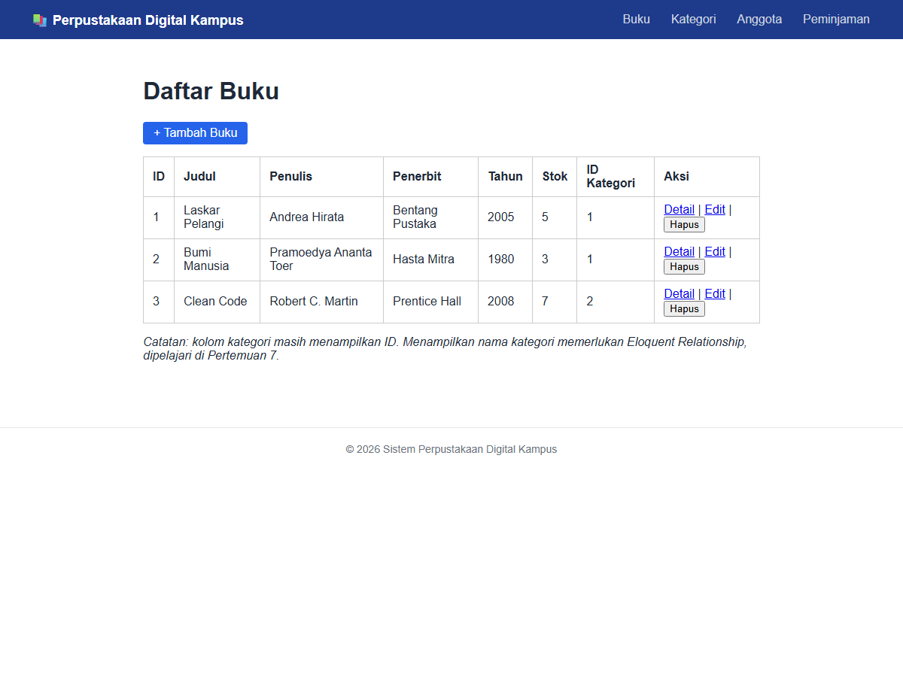

2. **Create (Form Tambah Buku)**: Form tambah buku yang telah mengadopsi master layout `@extends('layouts.app')` dan dropdown kategori terhubung ke database.
   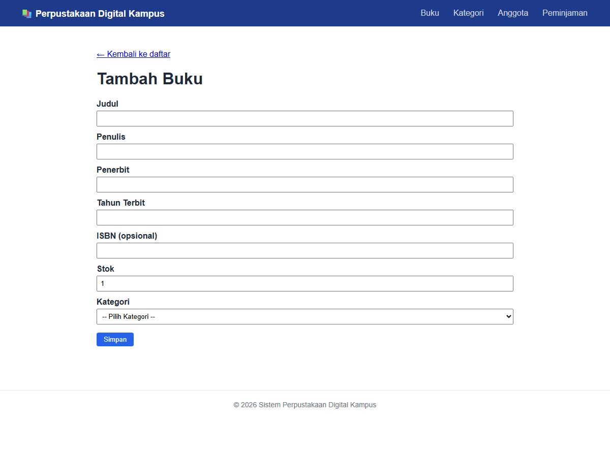

3. **Create Success (Hasil Simpan Buku)**: Data buku baru berhasil tersimpan ke database, redirect ke index disertai flash message sukses.
   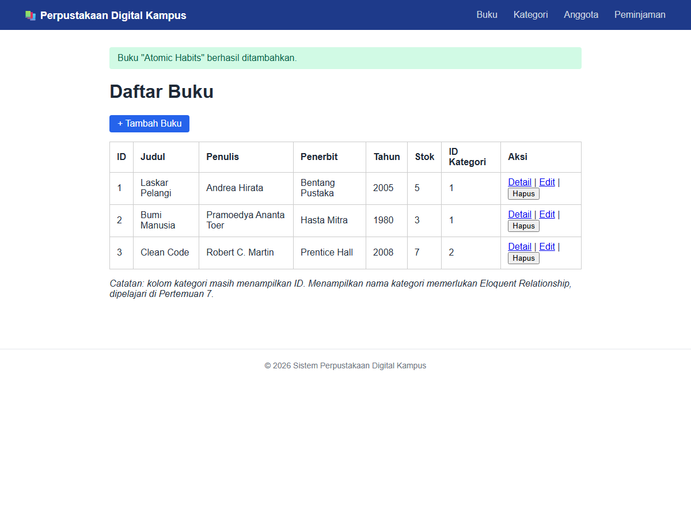

4. **Show (Detail Buku)**: Menampilkan rincian data buku berdasarkan ID menggunakan master layout.
   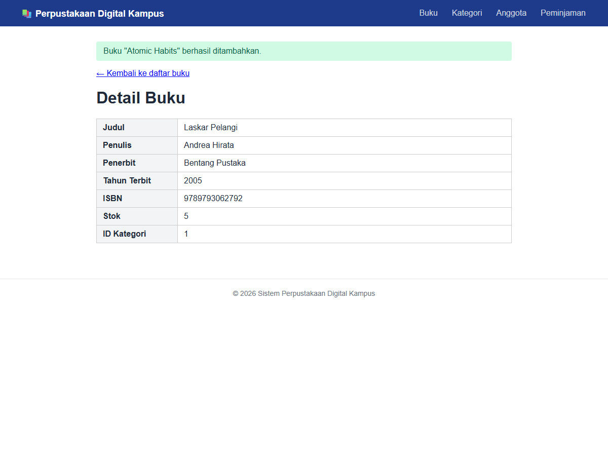

5. **Update (Form Edit Buku)**: Form edit buku yang ter-*prefill* otomatis dengan data buku yang dipilih.
   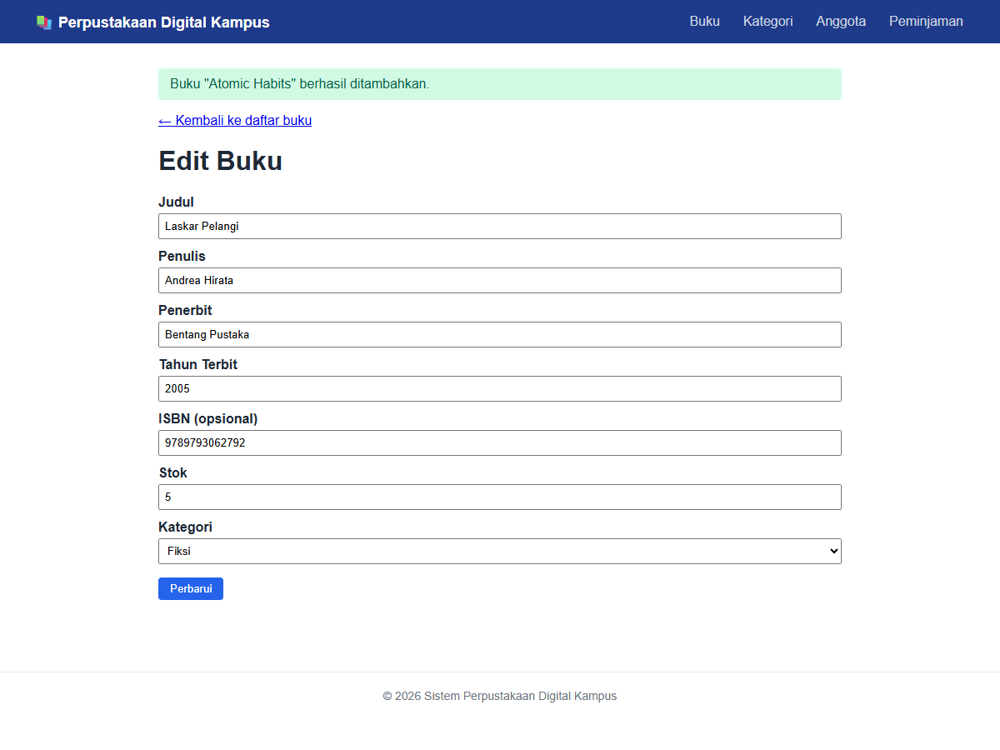

6. **Delete (Hasil Hapus Buku)**: Data buku berhasil dihapus dari database, tabel terbarui, dan flash message sukses ditampilkan.
   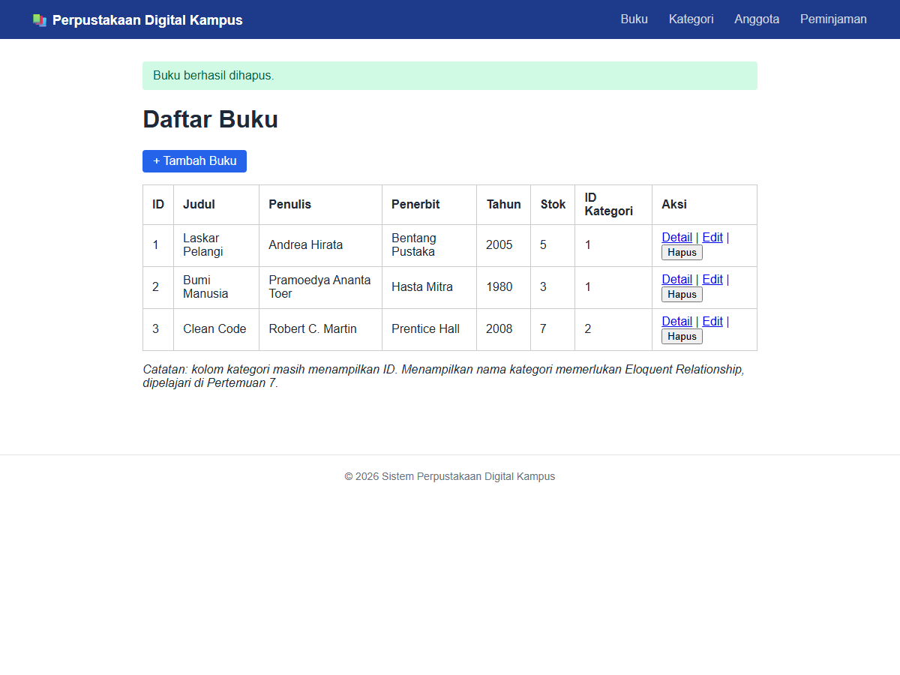

---

### B. Fitur CRUD Kategori (Categories)

1. **Read (Index) Kategori**: Daftar kategori buku tersimpan di database dengan pagination dan tombol aksi.
   

2. **Create (Form Tambah Kategori)**: Form input kategori baru menggunakan master layout.
   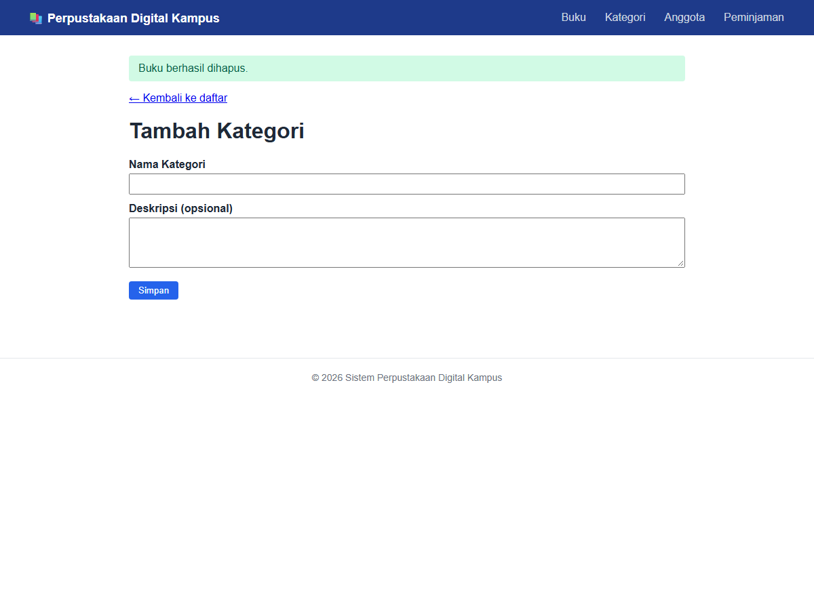

3. **Create Success (Hasil Simpan Kategori)**: Data kategori baru berhasil disimpan ke database beserta flash message sukses.
   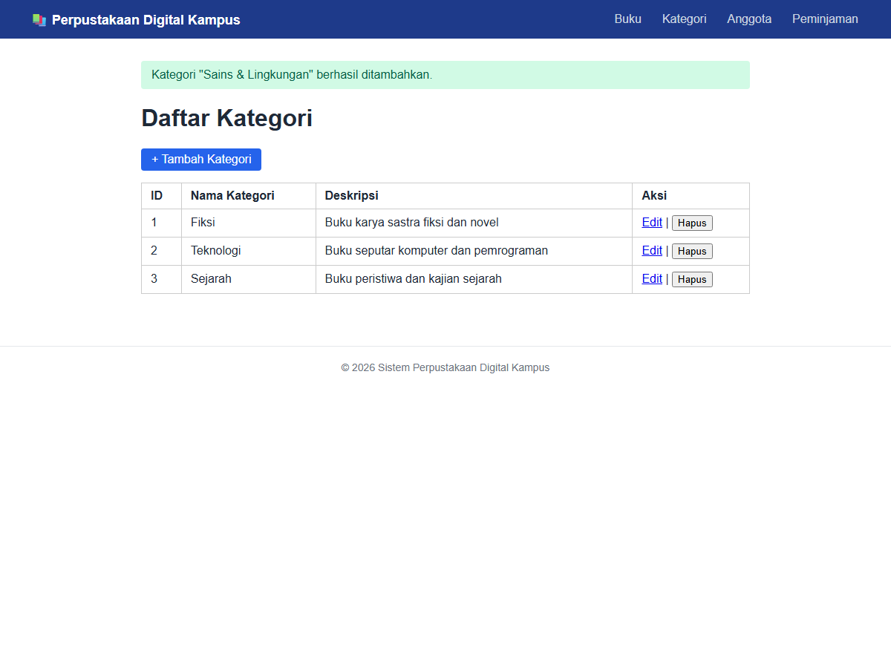

4. **Update (Form Edit Kategori)**: Form pembaruan kategori dengan *prefill* data lama.
   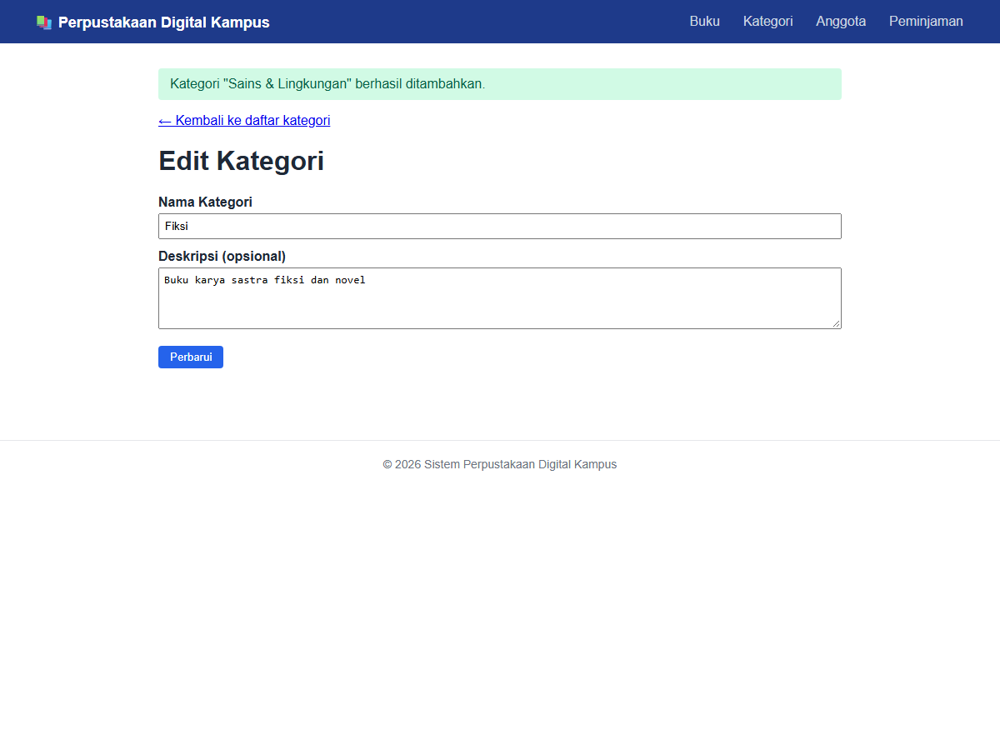

5. **Delete (Hasil Hapus Kategori)**: Kategori berhasil dihapus dari database MySQL dan hilang dari tabel index.
   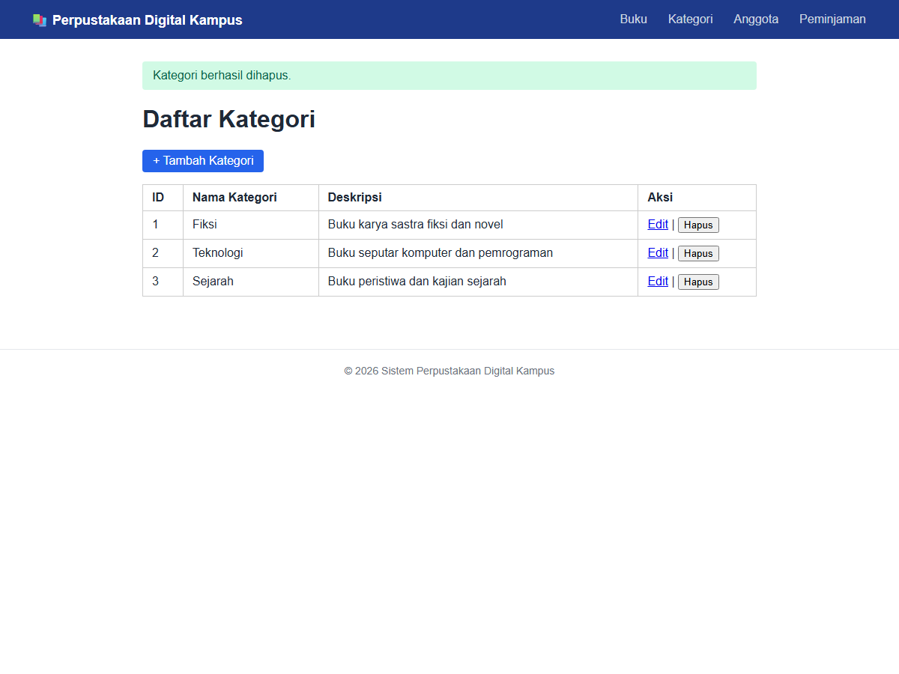

---

### C. Validasi Input (Server-Side Validation)

1. **Pesan Error Validasi Form Buku**: Tampilan feedback error validasi ketika form dikirim tanpa mengisi field wajib (*required fields*).
   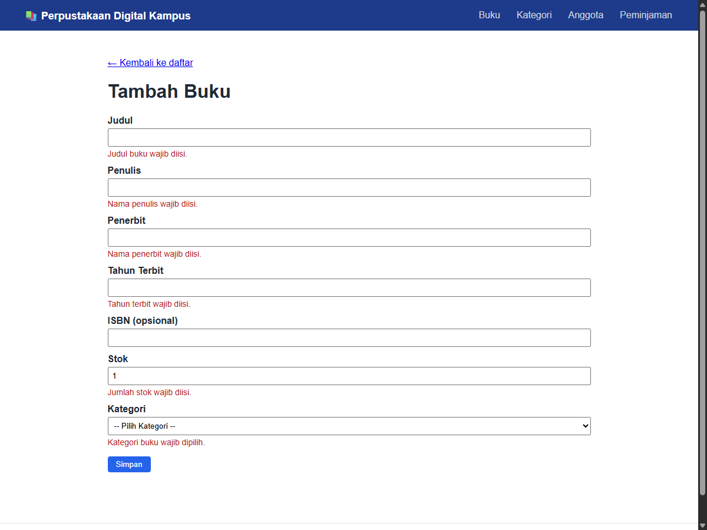

2. **Pesan Error Validasi Form Kategori**: Feedback error validasi saat nama kategori dikosongkan.
   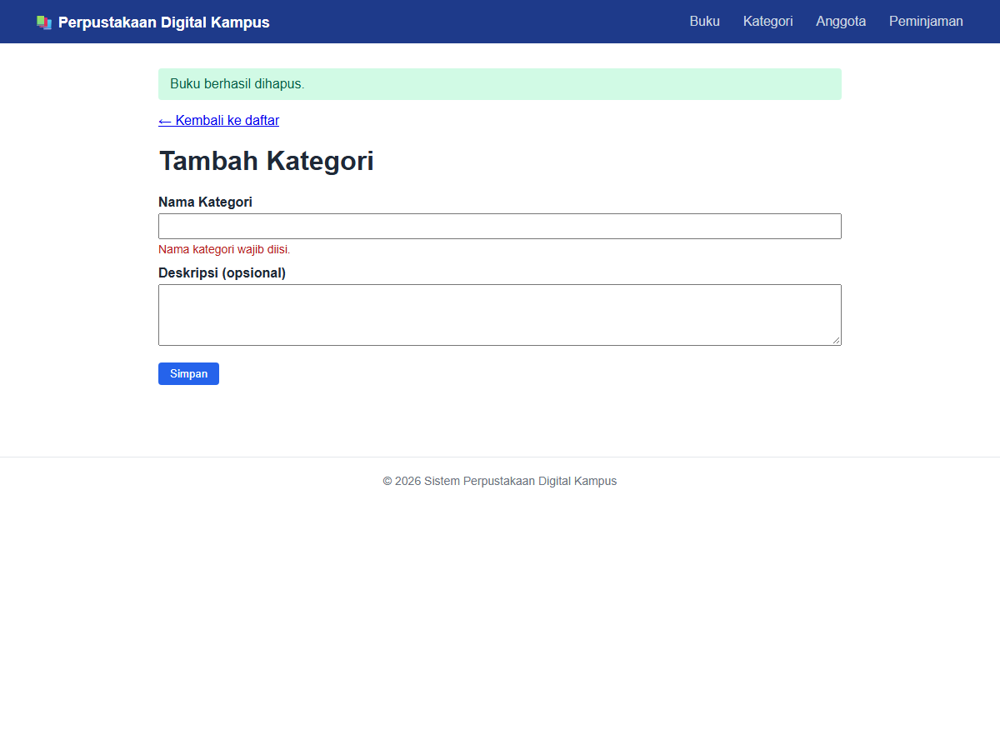

---

### D. Fitur CRUD Anggota (Members) - Bonus Tugas Mandiri P-5

1. **Read (Index) Anggota dengan Fitur Pencarian & Pagination**:
   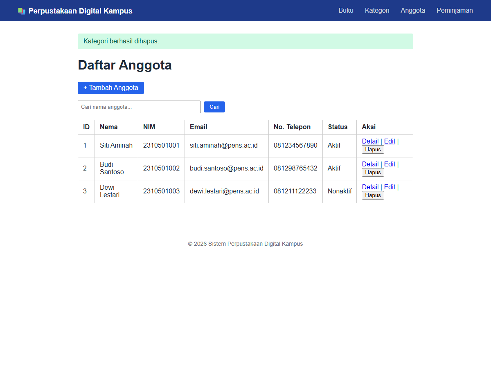

2. **Show (Detail Anggota)**:
   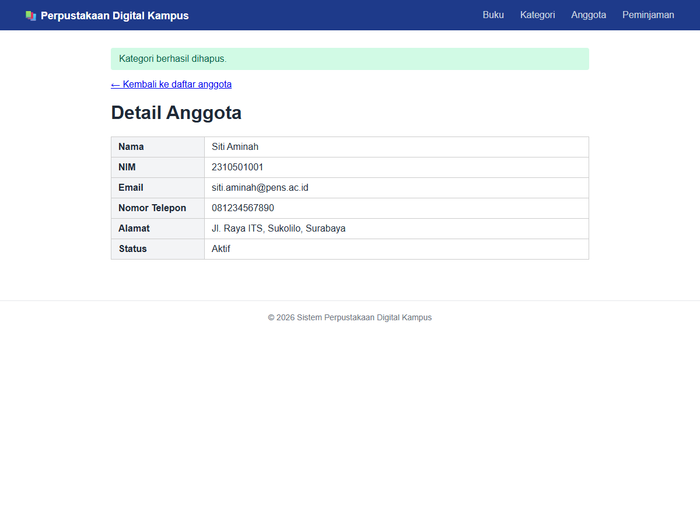

---

## 4. Penjelasan Konsep (Wajib Dijawab)

### 1. Masalah yang Muncul Jika Dibangun dengan PHP Native (Kaitan dengan Konsep MVC)
Jika aplikasi Sistem Perpustakaan ini dibangun menggunakan PHP native tanpa framework, arsitektur kode akan cepat mengalami degradasi menjadi *spaghetti code* seiring bertambahnya fitur dan kompleksitas tabel database. Pada pendekatan PHP native tradisional, satu file PHP (seperti `buku.php` atau `tambah_buku.php`) biasanya mencampuradukkan query SQL (`SELECT`, `INSERT`), penanganan request HTTP (`$_POST`, `$_GET`), sanitasi input, serta kode presentasi HTML dan CSS dalam satu tempat. Ketiadaan penerapan konsep MVC (*Model-View-Controller*) membuat pemisahan tanggung jawab (*separation of concerns*) hilang; perubahan kecil pada tampilan antarmuka (View) berisiko merusak logika bisnis atau query SQL (Model), dan sebaliknya. Selain itu, masalah duplikasi kode (*code redundancy*) akan merajalela, seperti pengulangan kode koneksi database, pengecekan autentikasi, serta boilerplate navigasi di setiap file. Dalam skala tim, hal ini memicu konflik penggabungan kode (*merge conflict*) yang masif karena frontend developer dan backend developer harus memodifikasi file yang sama, sehingga proses pemeliharaan (*maintainability*), pengujian (*testability*), dan skalabilitas aplikasi menjadi sangat lambat, mahal, dan rentan terhadap *bug* serta celah keamanan.

### 2. Alur Lengkap Request Saat Menekan Tombol "Simpan" Buku Hingga Kembali ke Index
Ketika petugas menekan tombol "Simpan" pada form tambah buku, alur perjalanan request melewati komponen-komponen berikut:
1. **Browser**: Mengirim HTTP request dengan method `POST` ke endpoint `/books` membawa payload input form beserta token perlindungan CSRF (`_token`).
2. **Web Server & Front Controller (`public/index.php`)**: Web server menerima HTTP request dan mengarahkannya ke `public/index.php` sebagai pintu masuk tunggal, yang kemudian memuat autoloader Composer dan menginisialisasi kernel aplikasi Laravel.
3. **HTTP Kernel & Middleware Pipeline**: Request disalurkan melalui tumpukan middleware global dan grup web, di mana middleware `ValidateCsrfToken` memverifikasi keabsahan token form untuk menangkal serangan Cross-Site Request Forgery, serta memulai session.
4. **Router (`routes/web.php`)**: Router mencocokkan method `POST` dan URI `/books` dengan Resource Route `books.store` yang diarahkan ke controller `BookController@store`.
5. **Form Request / Validation Layer (`StoreBookRequest`)**: Sebelum method controller dijalankan, Laravel memvalidasi payload input berdasarkan aturan yang didefinisikan (misal: `judul` string max 200, `tahun_terbit` integer antara 1900–tahun berjalan, `stok` integer minimal 0, dan `category_id` valid di tabel `categories`). Jika validasi gagal, Laravel otomatis melempar `ValidationException` dan mengalihkan (*redirect*) browser kembali ke form asal beserta data input lama (`old()`) dan daftar pesan error session (`$errors`). Jika valid, data bersih diambil via `$request->validated()`.
6. **Controller (`BookController::store`)**: Method controller menerima data yang telah tervalidasi dan mengeksekusi operasi pembuatan data melalui Eloquent ORM: `Book::create($validated)`.
7. **Eloquent Model & Database Layer (`App\Models\Book`)**: Model memeriksa atribut pada properti `$fillable` untuk mencegah *mass assignment*, lalu mengonversi array data menjadi query SQL `INSERT INTO books (...) VALUES (...)`, dan mengeksekusinya ke database MySQL via driver PDO.
8. **HTTP Redirect Response**: Controller mengembalikan response HTTP 302 Redirect ke route `books.index` disertai pesan flash session sukses `with('success', 'Buku "..." berhasil ditambahkan.')`.
9. **Browser Re-request**: Menerima status 302, browser secara otomatis mengirimkan request baru dengan method `HTTP GET` menuju URI `/books`.
10. **Controller Index & Eloquent Retrieval (`BookController::index`)**: Controller menangani request GET dengan mengambil data buku terpaginasi dari database via `Book::paginate(10)`, lalu memanggil view `books.index` dengan mengoper objek paginator `$books`.
11. **Blade Templating Engine**: Blade mengompilasi master layout `layouts/app`, menyematkan alert sukses dari partial `partials/alert` (yang membaca flash session), me-render tabel buku terbaru, dan menyusun link paginasi. Dokumen HTML lengkap dengan kode status `200 OK` dikirimkan ke browser hingga halaman daftar buku tampil kembali dengan data baru di layar petugas.

### 3. Urgensi Validasi di Sisi Server Meskipun Form HTML Sudah Memiliki Atribut `required`
Validasi di sisi browser (seperti penambahan atribut HTML5 `required`, `min`, `max`, atau pengecekan JavaScript) pada dasarnya hanya berfungsi sebagai peningkatan pengalaman pengguna (*User Experience* / UX) agar pengguna mendapat umpan balik visual secara instan tanpa perlu reload halaman. Namun, validasi sisi klien sama sekali **tidak dapat dipercaya** dari sudut pandang keamanan sistem karena berada di bawah kendali penuh pengguna di perangkat klien. Setiap pengguna atau penyerang dapat dengan sangat mudah mematikan JavaScript di browser, menghapus atribut `required` melalui fitur Inspect Element / Developer Tools, atau bahkan melewati antarmuka browser sepenuhnya dengan menembakkan HTTP request langsung menggunakan alat seperti cURL, Postman, script otomatis, atau ekstensi peretas. Oleh sebab itu, validasi di sisi server (Controller / Form Request) adalah satu-satunya benteng pertahanan yang menjamin integritas data dan keamanan aplikasi (*single source of truth*). Validasi server memastikan bahwa format data benar-benar sesuai tipe, bebas dari injeksi karakter berbahaya, memenuhi batas panjang, serta memeriksa integritas referensial dan aturan bisnis kritis ke database (seperti validasi `unique` pada NIM/email anggota atau validasi `exists` pada `category_id`) yang mustahil dilakukan secara aman di sisi klien.

### 4. Masalah yang Diselesaikan oleh Migration Dibanding Pengelolaan Database Manual (Konteks Kerja Tim)
Pengelolaan struktur tabel secara manual melalui GUI seperti phpMyAdmin atau eksekusi query SQL mandiri sangat rentan terhadap inkonsistensi skema database (*schema drift*) dan hilangnya jejak riwayat perubahan, terutama ketika bekerja dalam tim kolaboratif. Ketika seorang developer melakukan perubahan manual (misalnya menambah kolom baru, mengubah tipe data, atau menambahkan foreign key) di phpMyAdmin lokalnya, developer lain tidak akan mendapatkan perubahan tersebut secara otomatis. Tim harus saling mengirim file SQL dump atau teks instruksi query secara manual melalui chat/email, yang rawan terlewat, menimbulkan salah paham urutan eksekusi, serta berujung pada error runtime *"table or column not found"* di komputer rekan kerja atau server staging/produksi (*"it works on my machine"*). Migration menyelesaikan seluruh permasalahan tersebut dengan berperan sebagai sistem kendali versi (*version control system*) khusus untuk struktur database. Setiap perubahan skema ditulis dalam bentuk kode PHP yang terstruktur dan terikat waktu (*timestamped*), tersimpan rapi di dalam repositori Git bersama kode program lainnya. Ketika seorang anggota tim memperbarui repositori dengan `git pull`, mereka cukup menjalankan perintah tunggal `php artisan migrate`, dan seluruh perubahan struktur database akan diterapkan secara identik, konsisten, dan otomatis di lingkungan manapun. Selain itu, Migration menyediakan mekanisme *rollback* yang aman melalui method `down()`, memungkinkan tim membatalkan modifikasi skema dengan mudah apabila ditemukan kesalahan.

### 5. Definisi *Mass Assignment Vulnerability* dan Peran `$fillable` di Eloquent dalam Mencegahnya
*Mass assignment vulnerability* adalah sebuah celah keamanan perangkat lunak yang terjadi ketika aplikasi menerima seluruh parameter input dari HTTP request (misalnya melalui `$request->all()` atau method sejenis) dan langsung memasukkannya ke dalam operasi penyimpanan atau pembaruan database (seperti `Model::create($request->all())` atau `$model->update($request->all())`) tanpa proses penyaringan (*filtering*). Celah ini memungkinkan penyerang menyisipkan field atau atribut tambahan di dalam payload request—atribut yang sebenarnya tidak ditampilkan pada form antarmuka pengguna—seperti kolom `is_admin = 1`, `role = 'superadmin'`, `saldo`, atau `verified = true`. Jika kerentanan ini terjadi, penyerang dapat berhasil melakukan eskalasi hak akses (*privilege escalation*) atau memanipulasi data sensitif sistem secara ilegal. Eloquent ORM di Laravel secara mendasar mencegah ancaman ini melalui penerapan whitelist pada properti protected `$fillable` di dalam class Model. Properti `$fillable` bertindak sebagai daftar putih eksplisit yang menentukan kolom apa saja yang sah dan diizinkan untuk diisi secara massal. Ketika operasi mass assignment dijalankan, Eloquent akan secara otomatis memeriksa daftar `$fillable` dan mengabaikan (*strip out*) setiap atribut lain yang tidak terdaftar di dalamnya, sehingga data yang diselundupkan penyerang tidak akan pernah tersimpan ke dalam database.

---

## 5. Kendala & Solusi

1. **Kendala Inkonsistensi Layout Antarmuka Blade**:
   - *Kendala*: Pada awal pengembangan praktikum (Pertemuan 1 s.d. 3), view untuk form `edit` dan `show` dibangun dengan struktur HTML mandiri (`<!DOCTYPE html>`) dan CSS internal masing-masing. Ketika beralih ke master layout di Pertemuan 4 dan 5, terjadi inkonsistensi styling tampilan dan navbar tidak muncul di semua halaman detail/edit buku dan kategori.
   - *Solusi*: Melakukan refactoring menyeluruh pada seluruh view (`books/edit`, `books/show`, `categories/edit`, `members/*`) agar seragam mewarisi master layout `@extends('layouts.app')`. Bagian header dipindahkan ke `@section('title')`, konten utama dimasukkan ke `@section('content')`, serta notifikasi pesan sukses dipusatkan menggunakan partial view `@include('partials.alert')` dan `@include('partials.navbar')`.

2. **Kendala Integritas Relasi Foreign Key Database pada Operasi CRUD**:
   - *Kendala*: Ketika melakukan transisi penyimpanan dari array statis ke database MySQL nyata pada Pertemuan 5, pengujian penambahan buku sempat mengalami kegagalan (*foreign key constraint failure*) karena nilai `category_id` yang dimasukkan tidak ditemukan pada tabel `categories`.
   - *Solusi*: Menambahkan aturan validasi `'category_id' => 'required|integer|exists:categories,id'` pada Form Request dan Controller guna menjamin integritas referensial sebelum query insert dijalankan. Selain itu, dibuatkan file `DatabaseSeeder.php` yang secara otomatis mengisi data kategori awal (*Fiksi, Teknologi, Sejarah*) sehingga pengujian CRUD buku selalu memiliki data kategori referensial yang valid.
