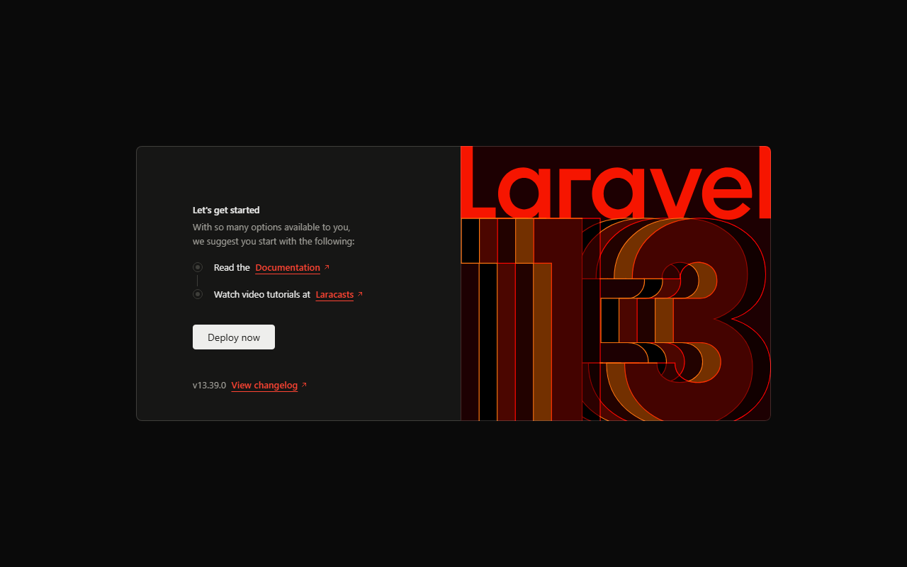

# App Perpustakaan (Sistem Perpustakaan Digital Kampus)

Aplikasi web Sistem Perpustakaan Digital Kampus yang dibangun menggunakan **Laravel 12**. Aplikasi ini dirancang untuk memudahkan petugas dan admin perpustakaan dalam mengelola data buku, data anggota, serta transaksi peminjaman dan pengembalian buku secara digital dan terstruktur.

---

## Pemahaman Arsitektur MVC (Model - View - Controller)

- **Model**: Bertanggung jawab atas pengelolaan data, aturan bisnis, serta komunikasi langsung dengan tabel database (seperti representasi tabel buku, anggota, dan peminjaman) menggunakan Eloquent ORM.
- **View**: Bertanggung jawab murni pada tampilan antarmuka pengguna (HTML/UI) menggunakan template engine Blade, bertugas menampilkan data yang sudah disiapkan tanpa memuat query atau logika bisnis yang rumit.
- **Controller**: Bertindak sebagai penghubung dan pengendali alur utama yang menerima request dari pengguna, memanggil Model untuk mengambil atau memperbarui data, lalu mengirimkan data tersebut ke View untuk ditampilkan kembali ke browser.

---

## Prasyarat Lingkungan (Prerequisites)

- **PHP**: >= 8.2 (dengan ekstensi `pdo_mysql`, `mbstring`, `intl`, `zip`, `fileinfo`)
- **Composer**: Dependency Manager untuk PHP
- **Database**: MySQL / MariaDB (misalnya via XAMPP)
- **VCS**: Git

---

## Cara Menjalankan Project Secara Lokal

1. **Clone repository:**
   ```bash
   git clone https://github.com/NexeusT/app-perpustakaan.git
   cd app-perpustakaan
   ```

2. **Beralih ke branch pengembangan (`dev`):**
   ```bash
   git checkout dev
   ```

3. **Install dependensi Composer:**
   ```bash
   composer install
   ```

4. **Konfigurasi Environment (.env):**
   Salin file konfigurasi jika belum ada dan generate Application Key:
   ```bash
   cp .env.example .env
   php artisan key:generate
   ```

5. **Konfigurasi Database MySQL:**
   Pastikan server MySQL (XAMPP) sudah aktif dan buat database bernama `db_perpustakaan`.
   Sesuaikan konfigurasi pada file `.env`:
   ```env
   DB_CONNECTION=mysql
   DB_HOST=127.0.0.1
   DB_PORT=3306
   DB_DATABASE=db_perpustakaan
   DB_USERNAME=root
   DB_PASSWORD=
   ```

6. **Menjalankan Development Server:**
   ```bash
   php artisan serve
   ```
   Aplikasi dapat diakses melalui browser di alamat: `http://127.0.0.1:8000`.

---

## Status Modul Praktikum

- **[P-1] Setup & Inisialisasi**: Selesai menginstal Laravel 12, konfigurasi database `db_perpustakaan`, pembagian branch `main` & `dev`, serta dokumentasi dasar.
- **[P-2] Routing & Request Lifecycle**: Selesai membuat resource controller (`BookController`, `CategoryController`, `MemberController`, `LoanController`), pendaftaran resource route beserta route kustom `loans.kembalikan`, serta route grouping `/admin`.

### Bukti Uji Coba Server (http://127.0.0.1:8000)



